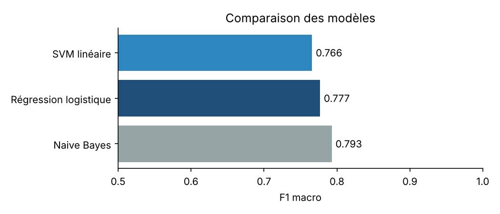
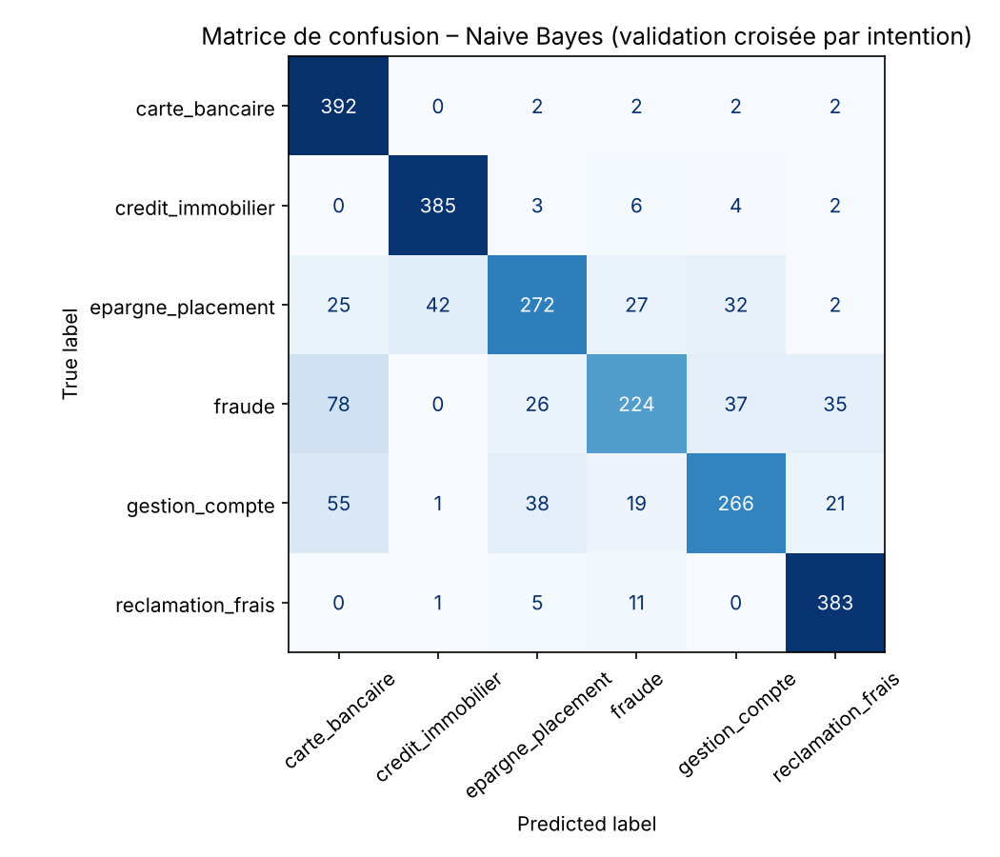

# 📨 Customer Request Routing – routage automatique des messages clients (NLP)

[](https://github.com/MERVEILLEKAMDEM/customer-request-routing/actions)

Une banque reçoit des milliers de messages par jour. Ce projet les **classe automatiquement en 6 catégories** et les envoie à la bonne équipe. Les fraudes passent en **priorité P1**.

```text
$ python src/route.py "Bonjour, je ne reconnais pas un débit de 89 € fait en Italie"
-> {'categorie': 'fraude', 'equipe': 'Cellule Fraude', 'priorite': 'P1 – sous 1 h'}
```

| Catégorie | Équipe |
|---|---|
| carte_bancaire | Service Cartes |
| credit_immobilier | Pôle Crédit Habitat |
| reclamation_frais | Service Réclamations |
| fraude | Cellule Fraude (P1) |
| epargne_placement | Conseillers Patrimoine |
| gestion_compte | Back-office Comptes |

## Une évaluation honnête

Les 2 400 messages d'entraînement sont **synthétiques**, générés à partir d'intentions × détails, avec fautes de frappe et registres variés. Un découpage aléatoire donnerait un score flatteur, car le modèle verrait les mêmes phrases à l'entraînement et au test. Deux protections sont donc en place :

1. **Validation croisée groupée par intention** (`GroupKFold`) : le modèle est testé sur des intentions qu'il n'a jamais vues.
2. **Test externe** sur 48 messages écrits à la main, indépendamment des gabarits.

| Modèle (TF-IDF mots + n-grammes de caractères) | F1 macro, CV par intention | F1 macro, test manuel |
|---|---|---|
| Naive Bayes | **0,793** | 0,870 |
| Régression logistique | 0,777 | 0,894 |
| SVM linéaire | 0,766 | **0,916** |

Les n-grammes de caractères rendent le modèle robuste aux fautes de frappe (« carte bloqéue »).

<p float="left">


</p>

## Lancer le projet

```bash
pip install -r requirements.txt
python src/make_dataset.py   # génère data/messages.csv
python src/train.py          # compare 3 modèles, sauvegarde le meilleur
python src/route.py "mon compte a été piraté"
python -m pytest -q
```

**Pistes** : remplacer TF-IDF par des embeddings de phrases (CamemBERT) et entraîner sur de vrais messages anonymisés. Un LLM pourrait aussi pré-rédiger la réponse au client.

---
Pascale KAMDEM · Data & IA · [LinkedIn](https://www.linkedin.com/in/merveille-kamdem-562aa0284/)
